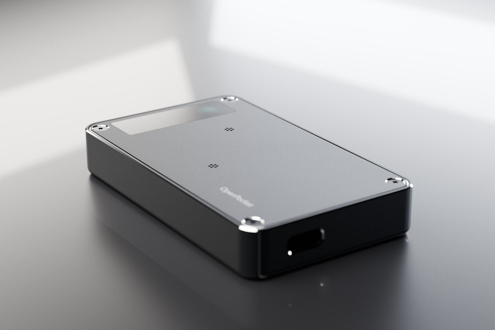
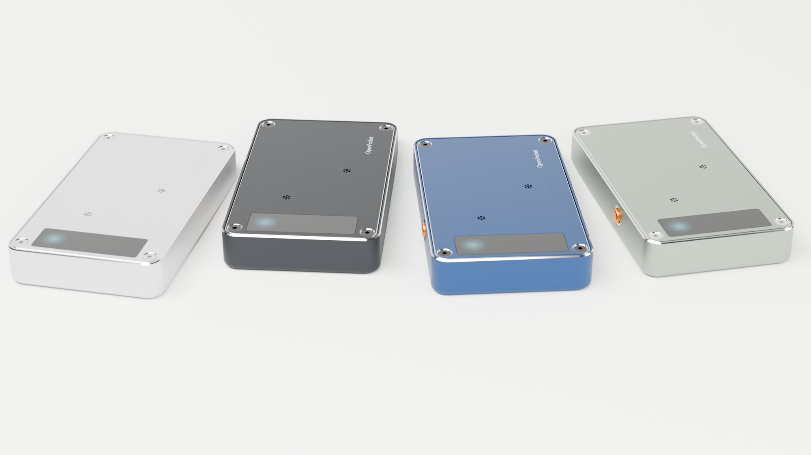
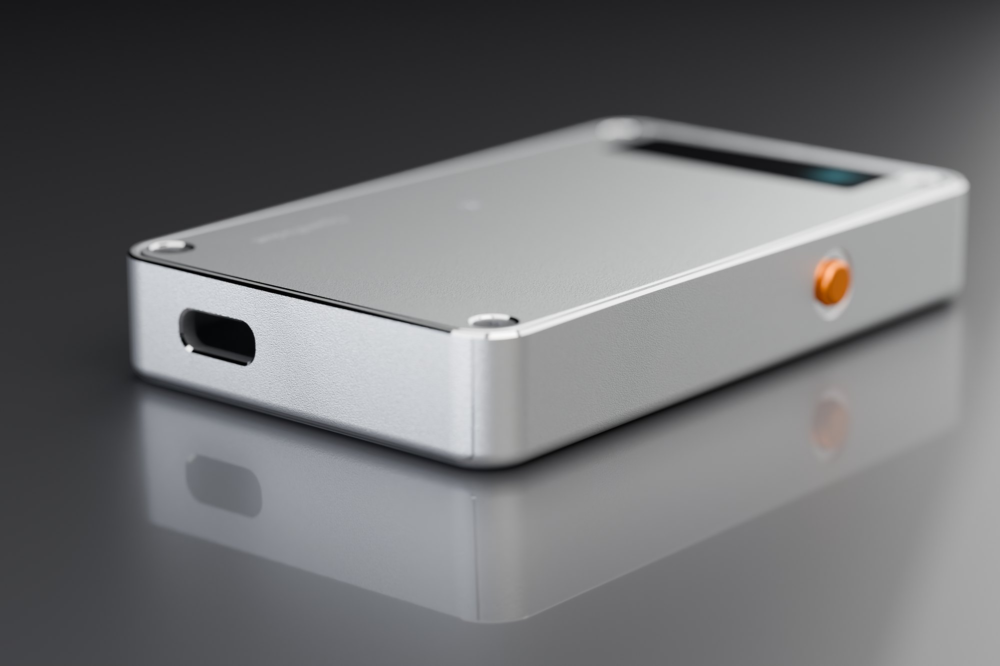
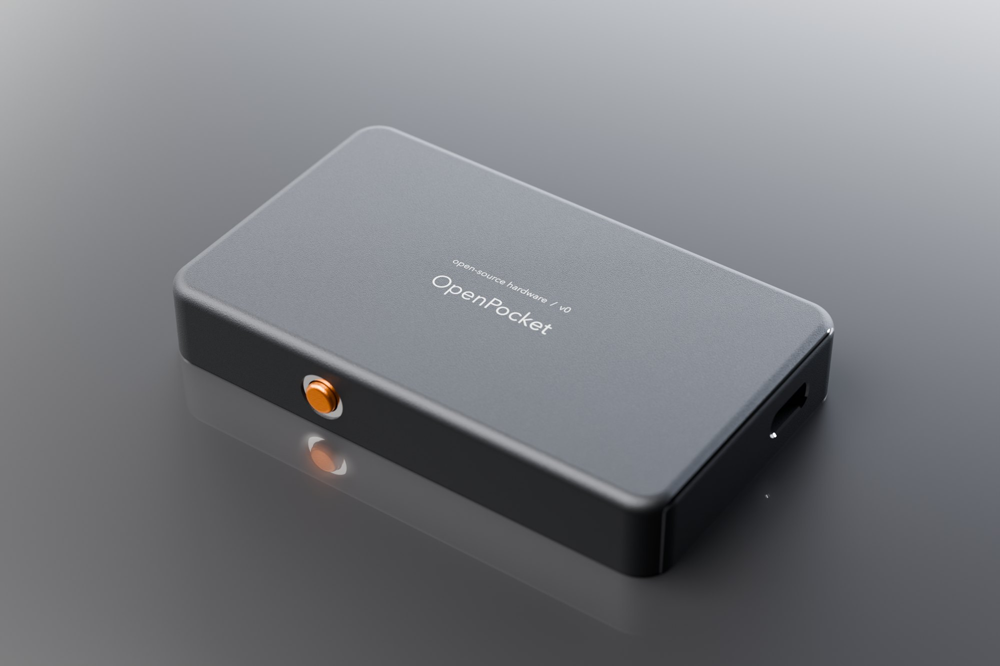
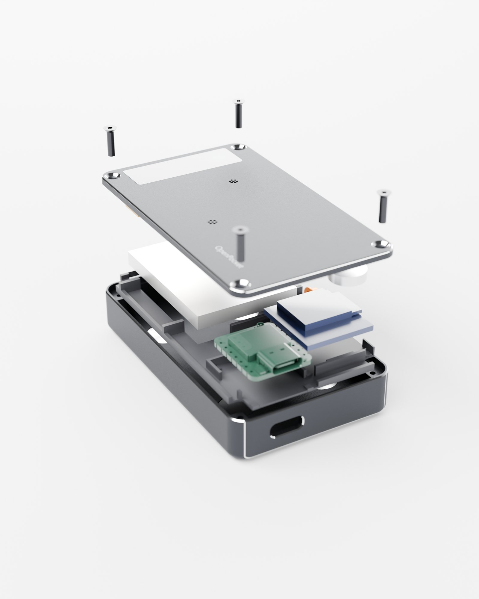
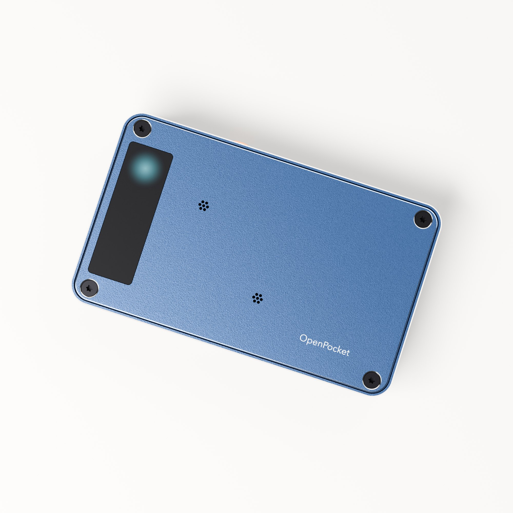
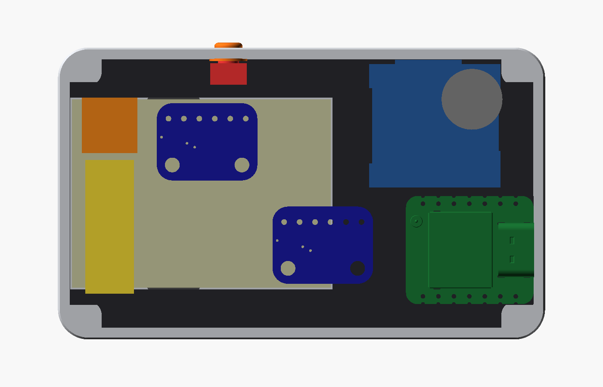
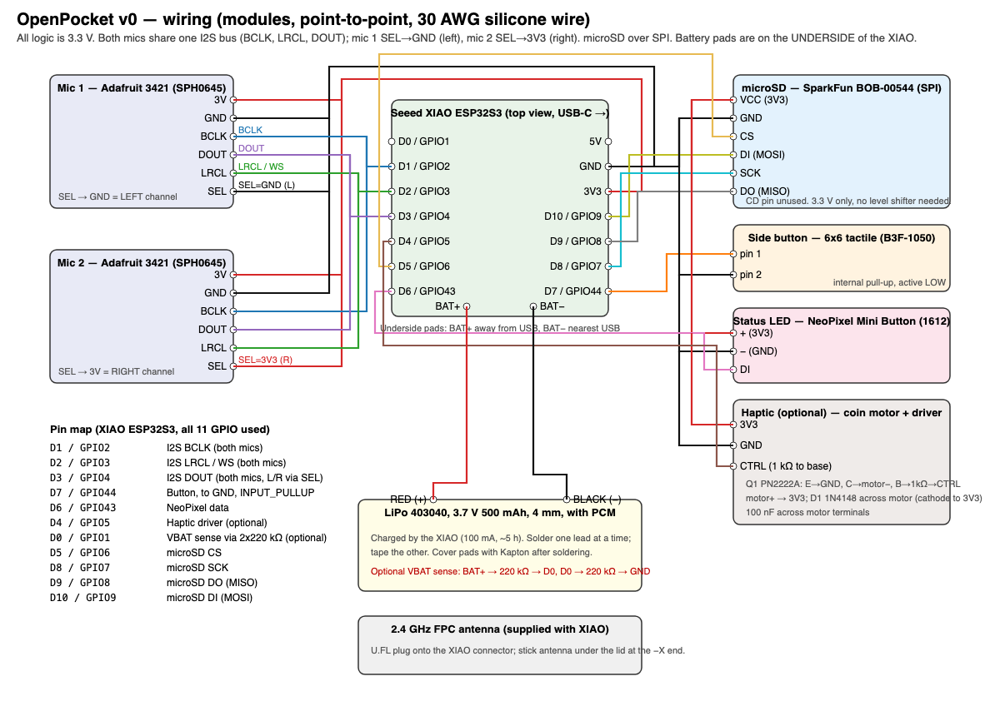
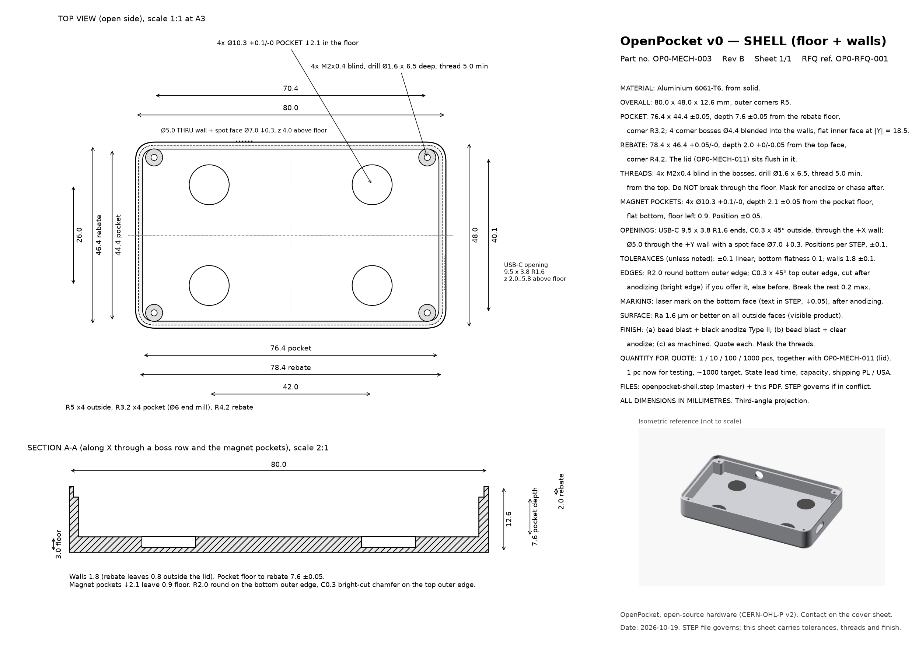
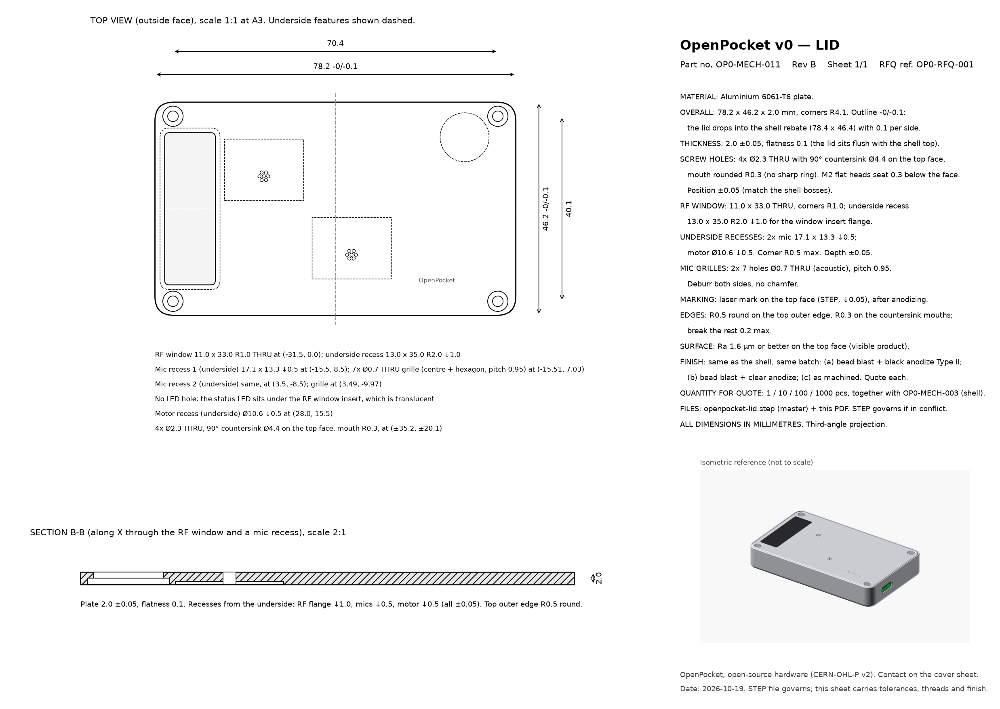

<p align="center">
  
</p>

<h1 align="center">OpenPocket</h1>

<p align="center">
  <b>Open-source DIY AI voice recorder in a machined aluminium case.</b><br>
  ESP32-S3 · 2 MEMS mics · microSD · USB-C · MagSafe magnets · 80 × 48 × 12.6 mm
</p>

<p align="center">
  
</p>

An open-source, build-it-yourself take on the [Pocket](https://heypocket.com)
AI voice recorder: a small screenless device in a machined aluminium case. It
has two microphones, records to a microSD card and sends recordings to your
laptop over BLE, Wi-Fi or USB, where they get transcribed.

**Status: design complete, not built yet.** The mechanics and wiring are done
and fit-checked in CAD, and the machining drawings are ready for a quote. The
firmware is only a spec so far. Expect changes after unit #1.

The whole design was done together with Claude (an AI agent) running Python
CAD, with me making the product calls. More about that below.

| | |
|---|---|
| Size | 80 × 48 × 12.6 mm, ~85 g |
| Brain | Seeed XIAO ESP32S3 (Wi-Fi, BLE, LiPo charging) |
| Storage | microSD (SparkFun breakout, captive card) |
| Audio | 2 × I2S MEMS mics (Adafruit 3421), mixed to mono MP3, 16 kHz |
| Power | LiPo 403040, ~500 mAh, charged over USB-C, ~10 h recording |
| Controls | one side button with an aluminium cap, an RGB status light under the lid window, optional haptic motor |
| Mount | 4 × Ø10 mm magnets in the floor (MagSafe compatible) |
| Case | CNC 6061 aluminium shell + lid, anodized; printed internal tray; 4 × M2 screws |

<table>
  <tr>
    <td width="50%"></td>
    <td width="50%"></td>
  </tr>
  <tr>
    <td align="center"><sub>Bright-cut edge, chamfered USB-C opening, captive aluminium button cap</sub></td>
    <td align="center"><sub>Laser-marked bottom; the magnets sit under 0.9 mm of aluminium</sub></td>
  </tr>
</table>

## Why the Pocket protocol

The firmware is specified to speak the same protocol as the original Pocket,
as reverse-engineered by [pocket-libre](https://github.com/shahcolate/pocket-libre).
That way the existing open-source desktop client (sync, local Whisper,
diarization, summaries) should work with OpenPocket unchanged. See
[`docs/firmware-spec.md`](docs/firmware-spec.md).

## What's inside

<table>
  <tr>
    <td width="50%"></td>
    <td width="50%"></td>
  </tr>
  <tr>
    <td align="center"><sub>Shell, printed tray with the electronics, lid, M2 screws</sub></td>
    <td align="center"><sub>7-hole mic grilles and the RF window that doubles as the status light</sub></td>
  </tr>
</table>

- `hardware/mechanical/cad/openpocket_cad.py`: the whole enclosure as one
  parametric CadQuery script. Every run checks for interference between all
  parts and verifies every component sits inside the cavity. It exits
  non-zero if anything clashes.
- `hardware/mechanical/export/`: STEP and STL for the shell, lid, tray, RF
  window insert and button cap, plus DXF outlines.
- `hardware/mechanical/drawings/`: machining drawings for the shell and lid
  (PDF, with tolerances, threads and finish).
- `hardware/mechanical/renders/`: OpenSCAD preview scene and the Blender
  script for the photo renders.
- `hardware/electronics/`: point-to-point wiring diagram.
- `bom/bom.csv`: bill of materials with suppliers, part numbers and prices.
- `docs/`: design spec, assembly guide, DFM review, firmware spec, related
  work.

## Building one

Roughly:

1. Order the electronics from `bom/bom.csv` (the core electronics came to
   about $33 per unit across Digi-Key, Mouser and JLCPCB; add the battery,
   microSD card, magnets and screws).
2. Print the tray and the RF window insert (`export/*.stl`, PETG, no supports).
3. Get the shell and lid machined. Send `openpocket-shell.step`,
   `openpocket-lid.step` and the two drawing PDFs to any CNC shop. Can't wait?
   Print them in PLA/PETG as a fit check first.
4. Wire it up per `hardware/electronics/wiring.png` and assemble per
   [`docs/assembly.md`](docs/assembly.md).

Again: nobody has built one yet. If you do, please open an issue with what
didn't fit.

### Technical views

<table>
  <tr>
    <td width="50%"></td>
    <td width="50%"></td>
  </tr>
  <tr>
    <td align="center"><sub>Inside with the lid off: battery, XIAO, microSD, mics (CAD)</sub></td>
    <td align="center"><sub>Point-to-point wiring</sub></td>
  </tr>
  <tr>
    <td></td>
    <td></td>
  </tr>
  <tr>
    <td align="center"><sub>Shell drawing (PDF in <code>hardware/mechanical/drawings/</code>)</sub></td>
    <td align="center"><sub>Lid drawing</sub></td>
  </tr>
</table>

## Regenerating the files

```bash
uv venv --python 3.11 .venv
uv pip install --python .venv/bin/python "cadquery==2.5.2" numpy matplotlib
.venv/bin/python hardware/mechanical/cad/openpocket_cad.py        # exports + fit check
.venv/bin/python hardware/mechanical/drawings/enclosure_drawings.py
.venv/bin/python hardware/electronics/wiring_diagram.py
(cd hardware/mechanical/renders && ./render.sh)                   # OpenSCAD previews
```

The vendor STEP models (XIAO, mic board) aren't included. See
[`hardware/mechanical/vendor-models/README.md`](hardware/mechanical/vendor-models/README.md).
The script works without them, it just skips that one check.

Photo renders: `blender -b --factory-startup -P hardware/mechanical/renders/blender/scene.py -- --meshes <export/render + export> --out <dir>`
(Blender 4.2, Cycles; slow on a laptop, fine on a big CPU box).

## How it was made

I wanted to see how far a plain Claude agent gets on a real hardware project
with ordinary tools: Python CAD, OpenSCAD, matplotlib, Blender, a parts-sourcing
MCP server for stock and prices. It wrote the CAD, ran the fit checks, did a
DFM pass on its own design, made the drawings, BOM and wiring, and scripted
the renders. I made the decisions (thinner, all-metal, colours) and reviewed
the result as an engineer.

## License

Hardware: [CERN-OHL-P v2](LICENSE). Scripts: MIT. Vendor models remain under
their owners' terms. Not affiliated with Pocket.
